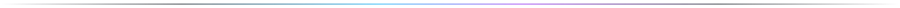
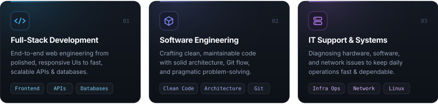
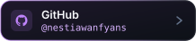
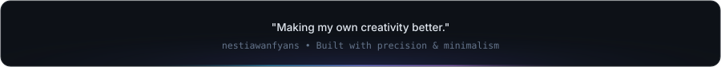

<div align="center">
  
</div>

<div align="center">
  <a href="https://github.com/nestiawanfyans">
    
  </a>
</div>

<br />

<div align="center">
  
</div>

### `01` — About & Core Focus

<div align="center">
  
</div>

<br />

```ts
const nestiawan = {
  name: "Nestiawan Ferdiyanto",
  location: "Bandar Lampung, Indonesia",
  roles: ["Full-Stack Developer", "Software Engineer", "IT Support"],
  focus: ["Modern Web Apps", "Clean Architecture", "System Reliability"],
  motto: "Making my own creativity better.",
};
```

<div align="center">
  
</div>

### `02` — Tech Stack

<!-- AUTO-TECH-STACK:START -->
<div align="center">
  
</div>
<!-- AUTO-TECH-STACK:END -->

<p align="center">
  <sub><i>Auto-synced directly from my GitHub repositories via GitHub Actions.</i></sub>
</p>

<div align="center">
  
</div>

### `03` — GitHub Analytics

<div align="center">
  
  
</div>

<br />

<div align="center">
  
</div>

<div align="center">
  
</div>

### `04` — Contribution Snake

<div align="center">
  <picture>
    <source media="(prefers-color-scheme: dark)" srcset="https://raw.githubusercontent.com/nestiawanfyans/nestiawanfyans/output/github-contribution-grid-snake-dark.svg" />
    <source media="(prefers-color-scheme: light)" srcset="https://raw.githubusercontent.com/nestiawanfyans/nestiawanfyans/output/github-contribution-grid-snake.svg" />
    
  </picture>
</div>

<div align="center">
  
</div>

### `05` — Connect

<div align="center">
  <a href="https://www.linkedin.com/in/nestiawanfyans" target="_blank">
    
  </a>
  &nbsp;
  <a href="https://www.instagram.com/nestfyan/?hl=en" target="_blank">
    
  </a>
  &nbsp;
  <a href="https://github.com/nestiawanfyans" target="_blank">
    
  </a>
</div>

<br />

<div align="center">
  
</div>
